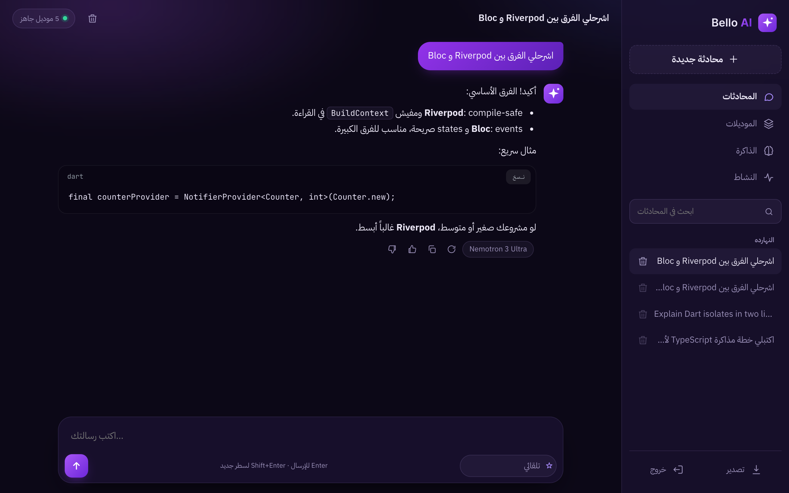
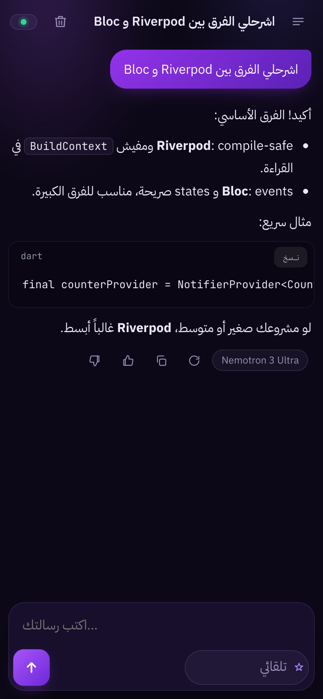
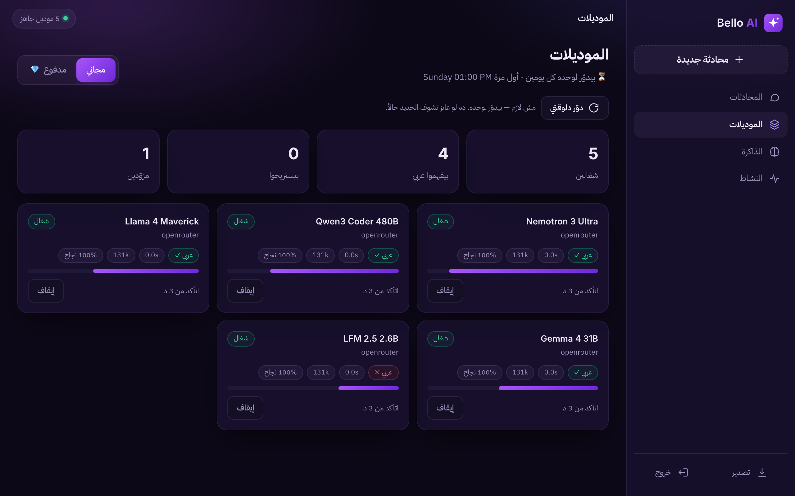
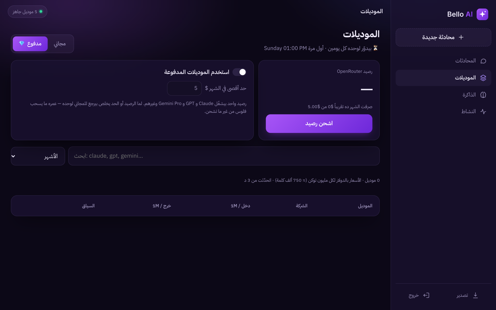
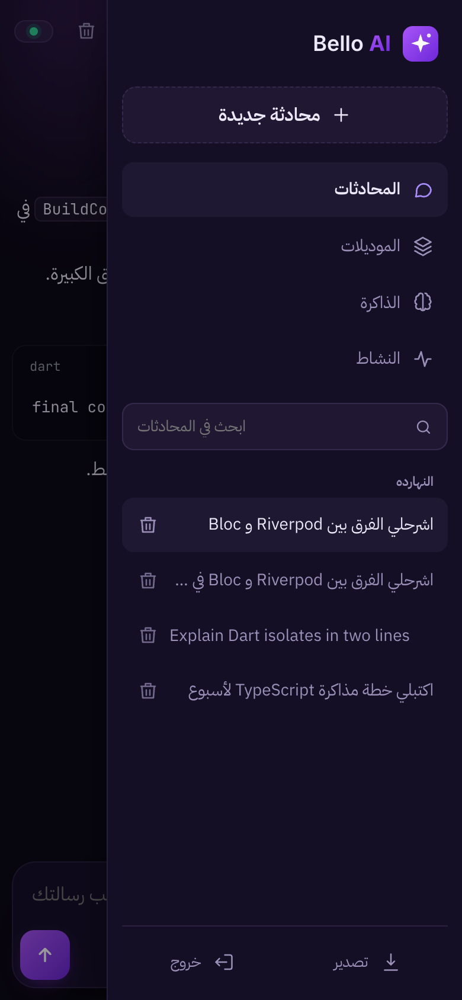

# Bello AI

A personal AI assistant on a public URL, for one owner, at **$0 a month**.
It talks to every free model it can find on Groq, Google Gemini, OpenRouter and Cloudflare Workers AI, picks the
best one for each message (Arabic or English, code or chat), switches to the next one when a model
hits its limit, and **adds new free models by itself** as soon as a provider publishes them.

مساعد شخصي بالذكاء الاصطناعي على رابط عام، لصاحبه بس، ومن غير أي تكلفة. بيختار أحسن موديل مجاني
لكل رسالة، ولو موديل خلص حده بيكمل على اللي بعده، وأي موديل مجاني جديد بينزل بيتجرّب ويتضاف لوحده.

<p align="center">
  
  
</p>

## What it does

- **Chat** with streaming, saved history, Markdown and code blocks, 👍/👎 that tunes the ranking.
- **Auto model choice**: language (Egyptian Arabic / MSA / English), task (code, reasoning, general),
  measured reliability and speed. Arabic never goes to a model that failed the Arabic test.
- **Fallback**: a model that returns 429/5xx before its first word rests (Retry-After, else
  1 → 2 → 4 min … up to 6 h) and the next model answers. Up to 4 tries per message.
- **Auto-discovery** every 2 days by default — change it in [`config/scan.ts`](config/scan.ts). New free
  models are quick-tested with an Arabic question and switched on if they pass. Models the provider
  drops are marked removed.
- **Paid models, off by default**: the models page lists every paid model with its price per 1M
  tokens. Top up OpenRouter credits, switch paid mode on, allow the models you want, set a monthly
  cap. Empty credits or a reached cap → back to free models; it never spends without credits.
- **Pictures and files**: attach up to 4 pictures and 3 files (PDF, text, code) — or paste / drop
  them. Pictures are shrunk to JPEG in the browser and go to a model that reads images; PDF text is
  read in the browser with pdf.js, and a scanned PDF goes as page pictures.
- **Web search** (🌐): Groq's gpt-oss models search and open pages themselves (free on Groq's
  plan); the answer shows the pages it read. Switches itself on for news, prices and weather.
  (Gemini's Google Search grounding is no longer free on current models.)
- **Compare** (⚖️): three different models answer side by side; the one you keep is saved and earns
  the model a point.
- **Auto titles**: a fast model names each new conversation while the answer streams.
- **Memory**: notes about you; pinned ones always go in, the rest only when they match the message.
- **Friends, without sharing your limits**: invite emails; they sign in with Google and add their
  own free keys (a guided page, ~2 minutes). Keys are AES-256-GCM encrypted, bound to the user and
  provider. Each person has their own chats, memory, usage and rate-limit rests; Workers AI and paid
  models stay the owner's. Removing a member deletes all their data.
- **Picks by measured skill**: every model sits a 9-question exam (code, reasoning, Egyptian
  Arabic + MSA; one hard question each). The router ranks by the score for the kind of message,
  then reliability and speed. Re-taken monthly; new models take it within hours.
- **Secure**: Google OpenID Connect or the owner password (PBKDF2, 100k rounds); HttpOnly
  SameSite=Strict sessions, 5 password tries per IP per 15 min, same-origin check, strict CSP.
- **Nice to use**: 8 themes (purple, ocean, emerald, sunset, rose, gold, AMOLED, light), text size,
  voice input in Egyptian Arabic, read-aloud, share, quick actions (summarise, translate, fix,
  simplify, continue), haptics on Android.
- **Export** everything as one JSON file, and an **encrypted weekly backup** to a private GitHub
  repo (see *Backups*).
- **Phone first**: install it from the browser menu (Add to Home Screen) and it opens full screen
  like an app. Conversations grouped by day with search, regenerate the last answer, delete with
  a confirm.

| Models (free) | Paid models | Phone menu |
|---|---|---|
|  |  |  |

## How "free" is decided

There is no universal list of free models, so every model carries its evidence:

| Provider | How it is known to be free |
|---|---|
| OpenRouter | Its public catalog lists **every** price as `0`. No price, or any non-zero price → ignored. |
| Groq, Gemini | They have a permanent free plan. Use a key **with no billing attached**: a model the free plan does not cover answers `402` / `429 limit: 0` and is marked *paid*. |
| Cloudflare Workers AI | Built in, no key: the Workers Free plan's daily allocation (10,000 neurons) fails when used up and never bills. Models limited to paid plans answer `5035` and are marked *paid*. Ranked a little lower so the small budget is kept as backup. |
| Cerebras | **Leave it off for now.** As of 2026-11 new accounts get trial credits, not a free plan, and a test call cannot tell credits from free. |

> ⚠️ Never put a key from a paid / billing-enabled account here. On such a key every call can cost
> money and the app cannot tell the difference.

Paid models are re-checked weekly (free tiers change), failed ones daily.

## Stack

Cloudflare Workers (TypeScript, no framework) + D1 (SQLite) + static assets, all on the Workers
Free plan. No other services. Why, limits and trade-offs: [docs/ARCHITECTURE.md](docs/ARCHITECTURE.md).

## Run locally

```bash
npm install
cp .dev.vars.example .dev.vars
npm run hash-password -- "a long password"   # paste into OWNER_PASSWORD_HASH in .dev.vars
# add at least one free key in .dev.vars
npm run db:migrate:local
npm run dev                                   # http://localhost:8787
```

Then open **الموديلات → دوّر دلوقتي** once (after that the schedule in `config/scan.ts` does it).

## Deploy (free, ~10 minutes, once)

1. Free Cloudflare account → `npx wrangler login`.
2. `npx wrangler d1 create bello-ai` and put the printed `database_id` in `wrangler.jsonc`.
3. `npm run db:migrate:remote`
4. Secrets (only the providers you have):
   ```bash
   npx wrangler secret put OWNER_PASSWORD_HASH
   npx wrangler secret put GROQ_API_KEY        # console.groq.com
   # CEREBRAS_API_KEY: skip, trial credits only (see above)
   npx wrangler secret put GEMINI_API_KEY      # aistudio.google.com (no billing!)
   npx wrangler secret put OPENROUTER_API_KEY  # openrouter.ai
   ```
5. `npm run deploy` → `https://bello-ai.<your-subdomain>.workers.dev`.

**Auto-deploy from GitHub:** add the repo secrets `CLOUDFLARE_API_TOKEN` (template "Edit Cloudflare
Workers" + D1 edit) and `CLOUDFLARE_ACCOUNT_ID`. Every push to `main` then tests, migrates and deploys.

## Google sign-in (for friends, optional)

1. [console.cloud.google.com](https://console.cloud.google.com) → new project **Bello AI**.
2. **APIs & Services → OAuth consent screen**: External · app name *Bello AI* · your email ·
   scopes: only `openid`, `email`, `profile` → **Publish app** (basic scopes need no review).
3. **Credentials → Create credentials → OAuth client ID** → *Web application*
   - Authorized redirect URI: `https://bello-ai.<your-subdomain>.workers.dev/api/auth/google/callback`
4. Put the two values in secrets, plus the Google email that is you:
   ```bash
   npx wrangler secret put GOOGLE_CLIENT_ID
   npx wrangler secret put GOOGLE_CLIENT_SECRET
   npx wrangler secret put OWNER_EMAIL
   ```
5. Also once: `npx wrangler secret put KEYS_ENCRYPTION_KEY` with
   `node -e "console.log(require('crypto').randomBytes(32).toString('base64'))"`.
   Changing it later makes saved keys unreadable (people just re-add them).

Then **الأعضاء → ادعي** an email; that person opens the site and signs in with that Google account.

## Free-plan limits that matter

| Limit (Workers Free) | Value | Effect here |
|---|---|---|
| Requests | 100,000 / day | far above one person's use |
| CPU per request | 10 ms | fine: the Worker mostly waits on the network |
| Subrequests | 50 / invocation | ≤ 12 model tests per scan, ≤ 4 tries per message |
| Cron triggers | 5 / account | uses 1 |
| D1 | 5 GB, 5M rows read and 100k written / day | years of chat history |

Checked against developers.cloudflare.com on 2026-11-01. Free plans change; re-check now and then.

## Backups

`GET /api/backup` pages through the database for a GitHub Action in a **private** repo
(`bello-ai-backups`), which encrypts the dump (AES-256, `openssl -pbkdf2`) and commits it every
Friday, keeping the newest 12. Setup: a random `BACKUP_TOKEN` as a Worker secret and as a secret of
that repo, plus `BACKUP_PASSPHRASE` in that repo (keep a copy in your password manager). Sessions
and login attempts are not backed up. Restore:

```bash
openssl enc -d -aes-256-cbc -pbkdf2 -iter 200000 -in bello-ai-DATE.json.gz.enc | gunzip > backup.json
node scripts/restore-backup.mjs backup.json > restore.sql
npx wrangler d1 execute bello-ai --remote --file restore.sql
```

## Privacy

Free tiers may use your prompts to improve their models (Gemini's free tier says so; check each
provider's terms). Don't send secrets, passwords or private code you would not post publicly.
Your data (history, memory) stays in **your** D1 database; back it up with **تصدير** (Export).

## Roadmap

- [x] File upload (PDF / images for vision models)
- [x] Web search with sources
- [x] Encrypted weekly backups
- [ ] Semantic memory (Workers AI embeddings + Vectorize, both have free tiers)
- [ ] Weekly benchmark on your own prompts to replace the name-based quality guess
- [ ] Optional local models (Ollama) through Cloudflare Tunnel
- [x] Parallel "ask 3 models and compare" mode
